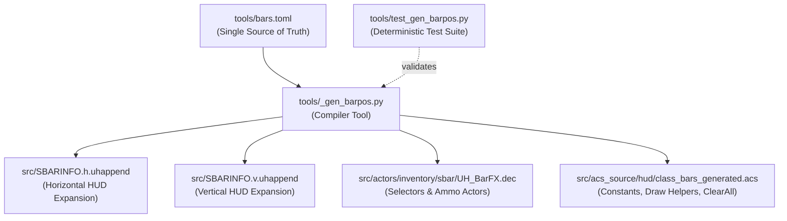

# Custom HUD Bar System

Unholy Razon 4 uses a **data-driven code-generation pipeline** for all custom player and weapon HUD bars. Instead of manually editing fragile SBARINFO lumps, declaring DECORATE inventory tokens by hand, and tracking numeric IDs across multiple ACS scripts, the entire custom bar subsystem is defined in a single configuration file: [`tools/bars.toml`](../tools/bars.toml).

The compiler tool [`tools/_gen_barpos.py`](../tools/_gen_barpos.py) translates this definition into synchronized SBARINFO expansions, DECORATE selector and ammo actors, and ACS constants and drawing helpers.

---

## 1. Design Motivation & Architecture

In vanilla MM8BDM (v6b) and standard Zandronum modding, implementing custom HUD bars presents several architectural bottlenecks:

### Bottlenecks of Legacy Approaches

1. **Runtime Clear Registry Exhaustion (`core_DrawBar_RegisterClear`)**:
   MM8BDM's BARLIB API allows scripts to register cleanup callbacks invoked when weapons, classes, or view targets change. However, `core_DrawBar_RegisterClear` maintains an internal fixed-size array (`UH_BAR_CLEAR_MAX`). If each class or weapon registers its own individual clear script, the registry silently overflows, causing active bar selectors to latch and remain permanently visible when morphing or switching weapons.
2. **Multi-Lump Synchronization Fragility**:
   Adding a single custom bar traditionally requires modifying four separate lumps:
   - **`DECORATE`**: Declaring an `Inventory` selector token with an exact `MaxAmount`, plus a virtual `Ammo` item with `+INVENTORY.IGNORESKILL`.
   - **`SBARINFO.H` & `SBARINFO.V`**: Writing nested `InInventory` conditional blocks and `DrawBar` lines with exact screen coordinates, orientations, fill textures, and empty textures.
   - **`ACS`**: Writing `#define` numeric constants, maintaining draw helper functions, and managing state logic.
   A single typo or mismatched ID results in silent HUD corruption.
3. **Texture Offset Displacement Trap**:
   In Zandronum's renderer (`sbarinfo.cpp` / `v_draw.cpp`), `DrawBar` clips a graphic to the current value but preserves the fill texture's own left/top offsets defined in `TEXTURES` or `ANIMDEFS`. If a fill frame carries a non-zero offset (e.g. `(-16, -8)`), the rendered fill is drawn displaced relative to the empty bar background.
4. **Curse Overlay & Status HUD Conflicts**:
   Bars must honor game-wide HUD flags (`DrawStatusBarFlag`, `NoHud`, `NoHealthBar`) and support status effects like Pharaoh Man's curse (`Pharaoh4MICurse_Unknown`), which replaces active bars with `CURSEVAR` / `CURSEBAR`.

### Unholy Razon's Solution



- **Single Source of Truth**: All bar graphics, positions, layer priorities, and sources are declared in `tools/bars.toml`.
- **Zero Runtime Registration Overhead**: All groups share a single generated client script `UHBar_ClearAll` registered once with `core_DrawBar_RegisterClear`.
- **Compile-Time Graphic Auditing**: `_gen_barpos.py` parses `TEXTURES*` and `ANIMDEFS*` to ensure every fill texture is completely offset-free and valid before writing code.

---

## 2. Configuration Schema (`tools/bars.toml`)

Every bar definition belongs to a named group. Groups correspond to logical units such as a survivor class, boss, or weapon.

```toml
schema_version = 1

[[groups]]
namespace = "UHBar_Neru"

[[groups.bars]]
id = "skill"
constant_name = "UHBAR_NERU_SKILL"
position = "1"
priority = 0
vertical_full = "55_X_BAR"
vertical_empty = "55_Y_BAR"
horizontal_full = "55_X_VAR"
horizontal_empty = "55_Y_VAR"
source = "MikAmmo"

[[groups.bars]]
id = "wrath"
constant_name = "UHBAR_NERU_WRATH"
position = "3"
priority = 1
vertical_full = "34_B_V11"
vertical_empty = "NOBAR"
horizontal_full = "34_B_H11"
horizontal_empty = "VNOBAR"
source = "UnholyPower500"
```

### Group Attributes

| Field | Type | Description |
|---|---|---|
| `namespace` | string | Unique PascalCase identifier for the group (e.g. `UHBar_Neru`, `UHBar_AtomicFireWepU`). Generates the draw helper function `<Stem>_DrawBar`. |

### Bar Entry Attributes (`[[groups.bars]]`)

| Field | Type | Description |
|---|---|---|
| `id` | string | Local identifier within the group (e.g. `skill`, `move_fire`, `charge_meter`). |
| `constant_name` | string | Public ACS constant identifier. Must start with `UHBAR_` and cannot exceed 31 characters (ACC limit). |
| `position` | string | Position bank: `"1"`, `"2"`, `"3"`, or `"HP"`. |
| `priority` | integer | Sparse layer priority (`>= 0`). Bars with lower priority are rendered underneath higher priority bars in SBARINFO. |
| `vertical_full` | string | Fill graphic texture for vertical/fullscreen HUD. |
| `vertical_empty` | string | Empty background texture for vertical/fullscreen HUD. |
| `horizontal_full` | string | Fill graphic texture for horizontal/normal HUD. |
| `horizontal_empty` | string | Empty background texture for horizontal/normal HUD. |
| `source` | string | *(Optional)* Existing inventory/ammo actor to bind directly. Mutually exclusive with `capacity`. |
| `capacity` | integer | *(Optional)* Maximum capacity integer for a virtual ammo actor. Mutually exclusive with `source`. |
| `reverse_mask` | boolean | *(Optional, default false)* Set to `true` if the fill graphic is deliberately transparent over an opaque empty bar. |
| `offset_fill_ack` | boolean | *(Optional, default false)* Set to `true` to declare a reviewed exception if a fill graphic has an intentional texture offset. |

---

## 3. Position Banks

Unholy Razon defines four standard position banks for screen coordinates:

| Bank | Description | Horizontal HUD `(X, Y)` | Vertical HUD `(X, Y)` | Standard Use Case |
|:---:|---|:---:|:---:|---|
| **`"1"`** | Pos 1 (Primary) | `(58, 184)` | `(16, 8)` | Main weapon ammo or primary character resource. |
| **`"2"`** | Pos 2 (Secondary) | `(58, 176)` | `(8, 8)` | Secondary ability meter, stacked above Pos 1. |
| **`"3"`** | Pos 3 (Tertiary) | `(58, 168)` | `(0, 8)` | Rage, wrath, or tertiary gauge, stacked above Pos 2. |
| **`"HP"`** | Pos HP (Health) | `(130, 184)` | `(24, 8)` | Custom player or boss HP overlay bars. |

Coordinates are calibrated to standard 320x200 SBARINFO virtual resolution and scale automatically with Zandronum's status bar scaling.

---

## 4. Generated Artifacts

### 1. SBARINFO Append Expansions (`src/SBARINFO.*.uhappend`)
`_gen_barpos.py` writes:
- `SBARINFO.h.uhappend` (`AppendStatusBar normal, forcescaled`)
- `SBARINFO.v.uhappend` (`AppendStatusBar fullscreen, forcescaled`)

Each bar translates to an inventory-banded check:
```c
InInventory "UHBar_Neru_P1L0Selector", 1 {
  InInventory not "UHBar_Neru_P1L0Selector", 2 {
    DrawBar "55_X_VAR", "55_Y_VAR", MikAmmo, horizontal, 58, 184;
  }
}
```
If Pharaoh Man's curse is active (`Pharaoh4MICurse_Unknown`), the cursed branch draws `CURSEVAR` / `CURSEBAR` instead of the standard fill.

### 2. DECORATE Actors (`src/actors/inventory/sbar/UH_BarFX.dec`)
For each bar group, selectors and virtual ammos are generated and appended below the `// $UH — TOML namespaced bar selectors / ammo` marker:
- **Selector Tokens**: Inherit from `Inventory`, with `Inventory.MaxAmount` set to the number of bars sharing that `(position, priority)` bank.
- **Virtual Ammo Tokens**: When `capacity` is specified instead of `source`, an `Ammo` actor is generated with `+INVENTORY.IGNORESKILL` and `Inventory.MaxAmount <capacity>`.

### 3. ACS Helpers & Constants (`src/acs_source/hud/class_bars_generated.acs`)
For each group, numeric `#define` macros and a draw helper are emitted:
```c
#define UHBAR_NERU_SKILL 1
#define UHBAR_NERU_WRATH 2

function void Neru_DrawBar(int id) {
  switch (id) {
    case UHBAR_NERU_SKILL:
      SetInventory("UHBar_Neru_P1L0Selector", 1);
      break;
    case UHBAR_NERU_WRATH:
      SetInventory("UHBar_Neru_P3L1Selector", 1);
      break;
    default:
      break;
  }
}
```
If a group contains virtual ammo bars, the helper signature accepts `(int id, int amount, int capacity)` and executes `SetAmmoAmountAndCapacity`.

---

## 5. State Management & Unified Clearing

### The `UHBar_ClearAll` Callback
To prevent `core_DrawBar_RegisterClear` registry overflow, `class_bars_generated.acs` declares a single unified script:

```c
script "UHBar_ClearAll" (int cam) CLIENTSIDE {
  SetActorInventory(cam, "UHBar_Amber_P1L0Selector", 0);
  SetActorInventory(cam, "UHBar_Neru_P1L0Selector", 0);
  ...
}

script "UHBar_ClearAll_Register" OPEN CLIENTSIDE {
  int result = ACS_NamedExecuteWithResult("core_DrawBar_RegisterClear", "UHBar_ClearAll");
  if (result < 0) {
    Log(s:"UHBar_ClearAll_Register: core_DrawBar_RegisterClear failed: ", i:result);
  }
}
```

This single registration resets all active custom bar selectors on class morph, weapon switch, or spectator target change across the entire mod.

---

## 6. Compiler Tool (`tools/_gen_barpos.py`)

The generator functions as a standalone compiler CLI.

### CLI Options

| Option | Flag | Description | Default |
|---|---|---|---|
| `--config` | `-c <FILE>` | Path to bar definitions TOML | `tools/bars.toml` |
| `--output-dir` | `-o <DIR>` | Mod source directory | `src` |
| `--check` | | Verification mode: check if files are up to date without writing; exits with `1` on drift | Disabled |
| `--verbose` | `-v` | Enable detailed diagnostic and progress output | Disabled |
| `--quiet` | `-q` | Suppress all informational output (errors only) | Disabled |

### Common Invocations

- **Regenerate all files**:
  ```bash
  python3 tools/_gen_barpos.py
  ```
- **Check for drift in CI or pre-commit hooks**:
  ```bash
  python3 tools/_gen_barpos.py --check
  ```
- **Verbose check with custom path**:
  ```bash
  python3 tools/_gen_barpos.py -c tools/bars.toml -o src -v --check
  ```
- **Run the deterministic test suite**:
  ```bash
  python3 tools/test_gen_barpos.py
  ```

---

## 7. Adding a New Custom Bar

To add a new HUD bar for a class or weapon:

1. **Add graphics**: Place PNG graphics in `src/graphics/` and register textures in `src/TEXTURES.bars` (or `src/ANIMDEFS.bars` for animations).
   > [!IMPORTANT]
   > Ensure fill graphics have zero offset (`offset 0, 0`). Offsets cause displacement during `DrawBar` rendering.
2. **Declare in `tools/bars.toml`**: Add a new `[[groups]]` block or a new `[[groups.bars]]` entry to an existing group.
3. **Compile**:
   ```bash
   python3 tools/_gen_barpos.py
   ```
4. **Call in ACS**:
   In your weapon or character HUD script (e.g. in `src/acs_source/hud/`):
   ```c
   // Direct source bar
   Neru_DrawBar(UHBAR_NERU_SKILL);

   // Virtual ammo bar with dynamic fill
   MyClass_DrawBar(UHBAR_MYCLASS_CHARGE, currentCharge, maxCharge);
   ```
5. **Verify**:
   ```bash
   python3 tools/_gen_barpos.py --check
   python3 tools/test_gen_barpos.py
   ./tools/compile-acs.sh
   ```
